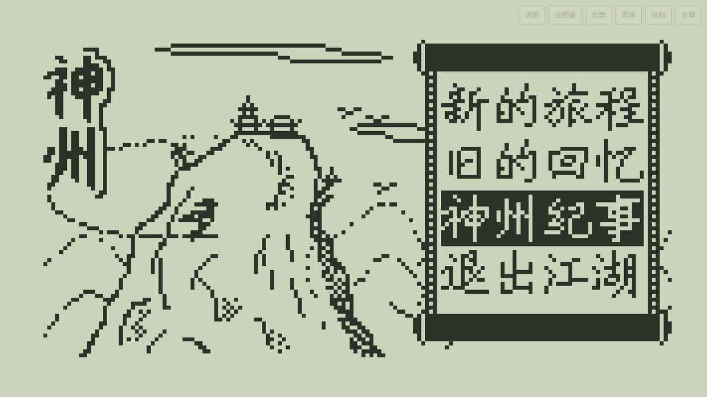
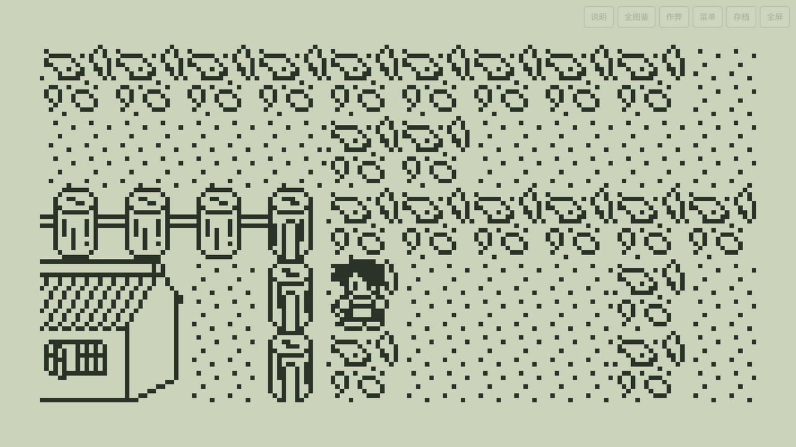

# 神州 H5

**在浏览器里重温 2004 年的 TI-89 经典 RPG。**

[🎮 在线游玩](https://congfeng12.github.io/shenzhou-h5/) · 单文件 · 离线可玩 · 键盘 / 鼠标 / 触屏



《神州》是 TOXIN Studio 于 2004 年发布的 TI-89 计算器角色扮演游戏（GVMaker 制作，TI-68k 移植：诗诺比）。本项目把原版 68k 引擎与 `GameSource.dat` 完整内嵌进一个 HTML 文件，在浏览器中逐条执行原版机器码，保留原版地图、剧情、战斗、数值与存档格式。

## 在线游玩

**<https://congfeng12.github.io/shenzhou-h5/>**

无需安装，桌面或手机浏览器打开即可。整个游戏只有 `index.html` 一个文件（约 850 KB），加载完成后可完全离线运行，也可以直接双击本地文件游玩。



## 特性

- **原版引擎**：内嵌 TI-89 版引擎与游戏数据，使用 JavaScript 实现的 68000 模拟器逐条执行，不是重制版。
- **原版画面**：160×100 单色点阵，整数倍缩放、像素锐利；地图视野保持原版 10×5 格。
- **键盘 / 鼠标 / 触屏**：
  - 大地图点一格，角色会像按方向键一样逐格走过去；
  - 遇到墙体、围栏等障碍会自动绕行，不会卡在障碍前；
  - 标题与菜单支持鼠标悬停高亮，只有点中按钮才会触发，点空白处不响应；
  - 手机可直接点画面操作。
- **存档**：游戏内存档写入浏览器 `localStorage`，支持导出 / 导入 4000 字节存档备份。
- **全图鉴**：内置原版道具、装备、法术、前缀、敌人数据，并读取当前进度。
- **作弊面板**：修改属性、道具、法术（仅影响当前运行内存，需在游戏内存档保存）。
- **全屏与离线**：支持全屏；双击 HTML 即可离线游玩。

## 操作说明

| 操作 | 按键 |
| --- | --- |
| 移动 / 选择 | `↑` `↓` `←` `→` |
| 确定 / 交谈 | `Enter` / `F1` |
| 返回 / 取消 | `Esc` / `Backspace` |
| 打开游戏菜单 | `F5` / `M` |
| 卸下装备 | `F2` / `N` |
| 鼠标 / 触屏 | 点地图行走；悬停菜单高亮；点按钮触发 |

在标题画面选择「新的旅程」开始，选择「旧的回忆」读取浏览器中的存档。

## 点击行走与菜单交互

- **逐格行走**：原版每走一格都要等一次完整的“按下 → 松开”输入周期（约 16 帧）。本项目每步只按 1～2 帧，等角色真的走完一格再走下一步，因此不会出现松手后连走多格或瞬移。
- **自动绕障（A\* 寻路）**：与 RPG Maker 触屏移动同思路——每走一步都用 A*（曼哈顿启发，搜索深度上限 64 格）现场计算“下一步往哪走”，撞到的墙只记下这条边，下次规划自动绕开；搜索深度内到不了目标时，会走向 A* 里离目标最近的格子，到最近点后自然停下，不会卡在障碍前或原地打转。
- **安全停止**：走到地图出口、切换地图或触发对话时立即停止，并清理尚未处理的行走按键，不会把旧方向的按键带进新场景。
- **菜单命中**：标题页是“深底浅字”的卷轴菜单，程序会识别卷轴边框、选中项和条目行；竖排菜单还要求点击落在菜单这一列内。悬停时按原版输入节奏移动光标，避免按键排队造成光标滞后跳动。

## 技术实现

- **CPU**：EstyJS 68000 解释器（GPLv2+），在浏览器中执行原版 TI-89 机器码。
- **加载**：从原版 `.89y` / `.89z` 变量文件提取引擎与数据，按原版 BSS 重定位表修正绝对地址，并把 68000 平台接口替换为 JavaScript 实现。
- **平台层**：实现原版的键盘轮询、文件打开 / 定位 / 读写、字体流、计时器、内存拷贝等 ROM 调用，适配原版 `Magic_Save.dat` 存档。
- **渲染**：直接读取原版 1bpp 显存（`0x4c00`，每行 30 字节），逐像素写入 Canvas。
- **交互**：点击行走采用“短按 → 松开 → 等待走完一格”的节奏控制；寻路与 RPG Maker 的 TouchMove 同思路，每走一步都用 A*（曼哈顿启发、搜索深度受限）现场规划下一步，撞墙记录碰撞边后自动绕行，目标不可达时走到离目标最近的格子停下；按键队列上限 8 条，窗口失焦或切换场景时清空队列，避免原版引擎集中回放。
- **单文件构建**：CPU、资源、运行时和 UI 全部内联到 `index.html`，无外部依赖，可直接部署到任意静态服务器。

> 构建产物中的 JavaScript 未压缩，包含 EstyJS、移植运行时和 UI 源码，便于审查与二次开发。

## 本地运行

直接双击 `index.html`，或在目录下启动任意静态服务器：

```bash
python3 -m http.server 8080
# 打开 http://127.0.0.1:8080/
```

## 存档

- 存档保存在当前浏览器的 `localStorage`（键名 `shenzhou-original-save-v1`）。
- 右上角「存档」可导出 `神州存档.sav`（4000 字节）备份，或导入备份。
- 清除浏览器数据会丢失本地存档，建议定期导出。
- 本地文件和 GitHub Pages 属于不同的浏览器存储域，存档不互通；换环境时请用导出 / 导入。

## 文件结构

```text
.
├── index.html          # 完整游戏（HTML + JS + 原版数据，单文件）
├── README.md
├── .nojekyll           # GitHub Pages 跳过 Jekyll
└── screenshots/
    ├── title.png
    └── game.png
```

## 常见问题

**打开后一直停在标题画面？**
标题菜单需要键盘或鼠标操作。可以先按 `Enter`，或用鼠标悬停到「新的旅程」后点击。

**点击地图后角色没有走到点击的位置？**
角色会按原版节奏一格格走，并绕开障碍；如果目标在墙里或不可到达，会在附近停下。走到地图出口时会切换地图并停止。

**存档在哪里？**
在游戏内菜单中保存后，进度写入当前浏览器的 `localStorage`。可在右上角「存档」中导出备份。

**手机上怎么玩？**
直接点画面即可；建议横屏或使用右上角「全屏」。右上角工具条常亮显示，任何界面都能直接点。

## 本次移植修复

- 点击移动改为逐格节奏 + A* 绕障寻路（每步重新规划、目标不可达时走到最近点），修复瞬移、走过头、上下方向被碰撞体卡住的问题。
- 标题菜单支持识别“深底浅字”的选中项和全部条目，悬停高亮，点击只对按钮生效。
- 点击画面黑边或状态栏不再被误判为地图落点。
- 行走 / 菜单输入不再堆积按键；窗口失焦、切换地图时清空残留按键，避免引擎集中回放。
- 补齐升级时大数值重绘用到的计算器图形接口（ROM 0x192），修复修改血量内力后升级报“尚未适配的计算器接口：0x192”的问题。
- 右上角工具条改为常亮显示并加阴影，不再因半透明而在游戏画面中难以辨认。
- 保留原版 10×5 视野和 160×100 显存布局，避免滚动缓冲越界。

## 致谢与版权

- 原版游戏：《神州》TOXIN Studio（FantasyDR、Athlon），2004。
- TI-68k 移植：诗诺比。
- 68000 模拟器：EstyJS（Darren Coles / Kai Eckert），GPLv2+。
- H5 移植与交互适配：congfeng12。

本项目仅用于学习、怀旧与计算器游戏保存（preservation），**请勿用于商业用途**。原版游戏、美术、文本与数据版权归 TOXIN Studio 及原作者所有；如权利人提出异议，将立即下架。EstyJS 部分遵循 GPLv2+，其源码已包含在 `index.html` 中。
